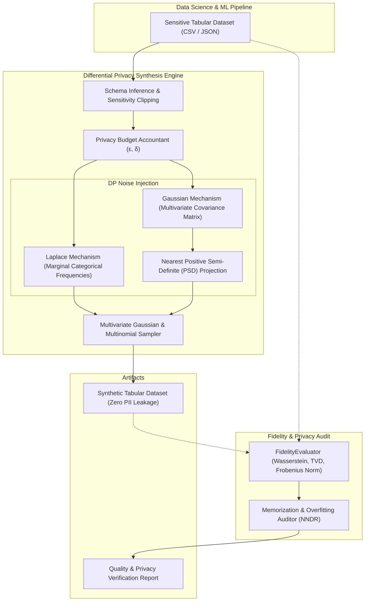

# 🧪 Privacy-Preserving Tabular Synthetic Data Generator

[](https://github.com/txltedxgod/synthetic-data-gen/actions/workflows/ci.yml)
[](https://www.python.org/)
[--DP-success.svg)](https://en.wikipedia.org/wiki/Differential_privacy)
[](https://opensource.org/licenses/MIT)

A mathematically rigorous tabular synthetic data generator implementing $(\epsilon, \delta)$-Differential Privacy (DP) with Laplace & Gaussian noise mechanisms, multivariate covariance modeling, sensitivity bounds clipping, and statistical fidelity evaluation.

---

## 🏛️ Architecture Overview



---

## ⚡ Key Capabilities

- **Mathematical $(\epsilon, \delta)$-Differential Privacy**: Guaranteed bounded privacy loss for every query and sample generation, preventing reconstruction and membership inference attacks.
- **Laplace & Gaussian Mechanisms**: Pure $\epsilon$-DP for histogram counts and approximate $(\epsilon, \delta)$-DP for covariance structures with analytically calibrated noise scales ($b = \Delta f / \epsilon$, $\sigma = \sqrt{2 \ln(1.25/\delta)} \cdot \Delta_2 f / \epsilon$).
- **PSD Matrix Projection**: Higham projection ensuring empirical covariance matrices perturbed by symmetric DP Gaussian noise remain positive semi-definite with positive eigenvalues ($\lambda_i \ge 10^{-4}$).
- **Privacy Budget Accounting**: Cumulative tracker enforcing compositional privacy expenditure limits across iterative synthesis tasks.
- **Statistical Fidelity Evaluation**:
  - **Marginal Divergence**: Quantile Wasserstein metric for continuous attributes; Total Variation Distance (TVD) for discrete categories.
  - **Correlation Matrix Preservation**: Frobenius norm difference on Pearson correlation matrices.
  - **Memorization Protection**: Nearest neighbor Euclidean distance ratio ensuring zero exact replicas.
- **High-Performance REST API**: FastAPI server with automated schema inference and Docker containerization.

---

## 🚀 Quickstart

### 1. Installation

```bash
git clone https://github.com/txltedxgod/synthetic-data-gen.git
cd synthetic-data-gen
python -m venv .venv
source .venv/bin/activate  # Or .venv\Scripts\activate on Windows
pip install -r requirements.txt
```

### 2. Python API

```python
from synth import TabularSynthesizer, FidelityEvaluator

# Real sensitive dataset
real_data = [
    {"age": 28, "department": "Engineering", "salary": 85000.0},
    {"age": 34, "department": "Marketing", "salary": 72000.0},
    {"age": 45, "department": "Engineering", "salary": 115000.0},
    {"age": 23, "department": "Sales", "salary": 58000.0},
    {"age": 39, "department": "Engineering", "salary": 98000.0},
]

# Initialize synthesizer with privacy budget
synthesizer = TabularSynthesizer()
synthesizer.fit(records=real_data, epsilon=1.5, delta=1e-5, random_seed=42)

# Generate 50 synthetic records
synthetic_data = synthesizer.generate(sample_size=50, random_seed=42)
print("Synthetic Sample:", synthetic_data[0])

# Evaluate statistical fidelity and privacy leakage risk
evaluator = FidelityEvaluator()
report = evaluator.evaluate(real_records=real_data, synthetic_records=synthetic_data)
print(f"Fidelity Score: {report.fidelity_score}% | Quality Gate Passed: {report.passed_quality_gate}")
```

### 3. Running with Docker / FastAPI

```bash
docker-compose up --build -d
```

Or run via Uvicorn:

```bash
uvicorn synth.api:app --reload --port 8000
```

---

## 📡 REST API Reference

### `POST /api/v1/synthesize`
Synthesizes tabular records from source data with differential privacy.

**Request Body:**
```json
{
  "records": [
    {"age": 25, "city": "Berlin", "income": 52000.0},
    {"age": 38, "city": "Munich", "income": 74000.0},
    {"age": 42, "city": "Berlin", "income": 88000.0}
  ],
  "sample_size": 100,
  "epsilon": 1.0,
  "delta": 0.00001,
  "random_seed": 42
}
```

**Response (200 OK):**
```json
{
  "records": [
    {"age": 27, "city": "Berlin", "income": 54120.5},
    {"age": 36, "city": "Munich", "income": 71830.2}
  ],
  "sample_size": 100,
  "privacy_report": {
    "spent_epsilon": 1.0,
    "spent_delta": 0.00001,
    "remaining_epsilon": 99.0,
    "total_epsilon": 100.0,
    "is_exhausted": false
  },
  "generation_time_ms": 14.25
}
```

### `POST /api/v1/evaluate`
Audits mathematical divergence and memorization risk between datasets.

### `GET /api/v1/privacy/budget`
Returns cumulative consumed and remaining privacy budget parameters.

### `GET /healthz`
Liveness probe for orchestration platforms (Kubernetes / ECS).

---

## 🧪 Testing

Execute the test suite with coverage:

```bash
pytest -v tests/
```

Suite covers:
- Laplace & Gaussian noise variance calibration.
- Bounded sensitivity clipping.
- Positive semi-definite projection under symmetric Gaussian perturbation.
- Categorical marginal distribution preservation.
- Fidelity metrics (Wasserstein distance & Frobenius norm correlation error).
- Fast integration tests against all REST endpoints.

---

## 📄 License

MIT License. See [LICENSE](LICENSE) for details.
